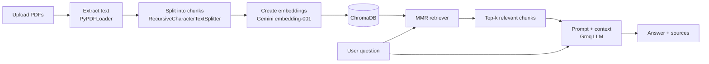

# 📄 Chat with Your PDFs

> Upload your documents, ask questions in plain English, and get answers grounded in your files, with the exact source and page shown for every response.


## 🎥 Live Demo

<!-- Replace VIDEO_LINK and THUMBNAIL_LINK with your own. See the note at the bottom of this file. -->

**▶️ [Watch the full demo video](https://www.youtube.com/watch?v=GzG_3-H2Muc)**

## 💡 What is this?

**Chat with Your PDFs** is a Retrieval-Augmented Generation (RAG) application. Instead of relying on a language model's memory, it retrieves the most relevant passages from *your* documents and asks the model to answer using only that context. If the answer isn't in the document, it says so instead of making something up.

## ✨ Features

- **Multi-PDF upload:** index several documents at once and query across all of them
- **Grounded answers:** the model is instructed to answer strictly from retrieved context and to admit when it can't find the answer
- **Source citations:** every answer comes with an expandable list of the file name, page number and passage that was used
- **MMR retrieval:** Maximal Marginal Relevance search returns relevant *and* diverse chunks, reducing repetitive context
- **Session isolation:** each user session gets its own vector collection, so documents from different users never mix
- **Quota-aware indexing:** embedding requests are batched, and rate-limit errors from the Gemini API are caught and retried automatically using the delay the API suggests
- **Tunable pipeline:** chunk size, overlap and number of retrieved chunks can be adjusted from the sidebar
- **Chat interface:** conversation history, progress bars during indexing, and one-click reset

## 🧠 How it works



1. **Ingest:** PDFs are read page by page, and each page keeps its file name and page number as metadata.
2. **Chunk:** text is split into overlapping chunks so context isn't lost at boundaries.
3. **Embed and store:** chunks are converted to vectors with Google's `gemini-embedding-001` and stored in ChromaDB.
4. **Retrieve:** the question is embedded and the most relevant, non-redundant chunks are fetched using MMR.
5. **Generate:** the retrieved chunks and the question are sent to the LLM through a strict, context-only prompt.
6. **Cite:** the retrieved chunks are shown alongside the answer so it can be verified.

## 🛠️ Tech Stack

| Layer | Technology |
|---|---|
| Frontend | Streamlit |
| Orchestration | LangChain |
| Embeddings | Google Gemini (`gemini-embedding-001`) |
| Vector database | ChromaDB |
| LLM | Groq (`openai/gpt-oss-20b`) |
| PDF parsing | PyPDF |
| Language | Python |

## 📁 Project Structure

```
chat-with-your-pdfs/
├── app.py                # Streamlit web app (upload, index, chat)
├── main.py               # Command-line version of the Q&A loop
├── create_database.py    # Script to index a PDF from the command line
├── requirements.txt      # Python dependencies
├── .env.example          # Template for required API keys
└── .gitignore
```

## 🚀 Getting Started

### Prerequisites

- Python 3.10 or higher
- A [Google AI Studio](https://aistudio.google.com/) API key (for embeddings)
- A [Groq](https://console.groq.com/) API key (for the LLM)

### Installation

```bash
# 1. Clone the repository
git clone https://github.com/Ankana-Sadhukhan/chat-with-your-pdfs.git
cd chat-with-your-pdfs

# 2. Create and activate a virtual environment
python -m venv .venv

# Windows
.venv\Scripts\activate
# macOS / Linux
source .venv/bin/activate

# 3. Install dependencies
pip install -r requirements.txt
```

### Configuration

Copy the example environment file and add your keys:

```bash
cp .env.example .env      # Windows: copy .env.example .env
```

```env
GOOGLE_API_KEY=your_google_api_key_here
GROQ_API_KEY=your_groq_api_key_here
```

> 🔒 `.env` is listed in `.gitignore`, so your keys are never committed.

### Run the app

```bash
streamlit run app.py
```

Open the local URL shown in the terminal (usually `http://localhost:8501`).

## 📖 Usage

1. Upload one or more PDF files from the sidebar.
2. Click **Process documents** and wait for indexing to finish.
3. Ask questions in the chat box.
4. Open the **Sources** expander under any answer to see where it came from.
5. Click **Clear documents & chat** to start over with new files.

## ⚙️ Design Decisions

- **Why MMR instead of plain similarity search?** Plain similarity often returns several near-duplicate chunks. MMR balances relevance with diversity, so the model sees a broader slice of the document.
- **Why a strict context-only prompt?** It reduces hallucination and makes the system's behaviour predictable and easy to verify.
- **Why a collection per session?** It prevents one user's documents from appearing in another user's answers in a multi-user deployment.
- **Why retry logic around embeddings?** Free-tier API quotas are easy to hit on large PDFs. Reading the suggested retry delay from the error lets indexing finish instead of crashing.

## ⚠️ Limitations

- Scanned or image-only PDFs have no extractable text and need OCR first.
- Each question is answered independently; the chat history is displayed but not used as conversation memory.
- Answer quality depends on chunking settings and on the quality of the PDF's text extraction.

## 🔮 Future Improvements

- [ ] OCR support for scanned PDFs
- [ ] Conversational memory (follow-up questions)
- [ ] Support for DOCX, TXT and web pages
- [ ] Streaming responses
- [ ] Re-ranking for better retrieval accuracy
- [ ] Docker setup and cloud deployment

## 👩‍💻 Author

**Ankana Sadhukhan**

- GitHub: [@Ankana-Sadhukhan](https://github.com/Ankana-Sadhukhan)
- LinkedIn: [@Ankana-Sadhukhan](https://www.linkedin.com/in/ankana-sadhukhan-39754237b)

If you found this project useful, consider giving it a ⭐

---